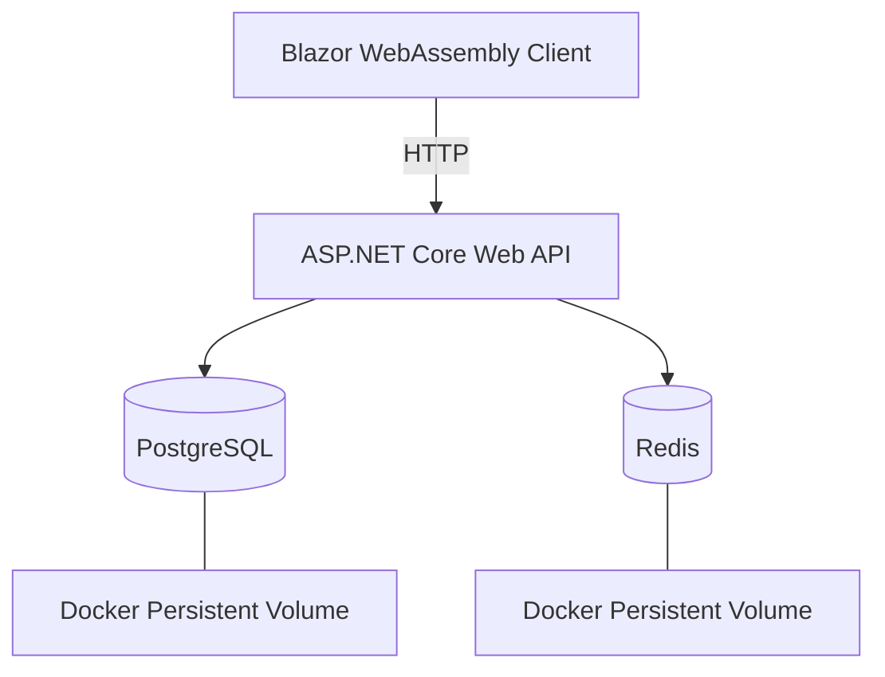

# **EventBooking — V0.1: Environment & Solution Foundation**

## **V0.1 — Foundation**

Build the environment before the business logic

**Stack:** .NET 10 · ASP.NET Core Web API · Blazor WebAssembly · PostgreSQL 16 · Redis 7 · Docker Compose · PowerShell

## **1. Mục tiêu của V0.1**

Trong version này, chúng ta chưa làm bất kỳ nghiệp vụ booking nào. Mục tiêu là tạo một development environment đủ vững để những version sau chỉ cần tập trung vào business logic.

Sau V0.1, bạn sẽ có:



Cụ thể:

- Một Git repository sạch.
- Một .NET Solution.
- ASP.NET Core Web API chạy được.
- Blazor WebAssembly chạy được.
- PostgreSQL chạy bằng Docker.
- Redis chạy bằng Docker.
- Persistent volumes.
- Health checks.
- API kết nối thành công cả PostgreSQL và Redis.
- Blazor gọi được API qua HTTP.
- Swagger hoạt động.
- Có thể khởi động lại toàn bộ stack theo một quy trình rõ ràng.

**Estimated time:** 2–4 giờ nếu môi trường đã sẵn sàng; có thể lâu hơn nếu Docker hoặc SDK cần sửa.

# **Step 0 — Kiểm tra môi trường**

Mở PowerShell 7, không cần chạy dưới quyền Administrator.

## **0.1. Kiểm tra .NET**

```
dotnet --info
dotnet --list-sdks
dotnet --list-runtimes
```

Kiểm tra SDK version:

```
dotnet --version
```

Chúng ta sẽ sử dụng .NET 10 (`net10.0`) cho project này. .NET 10 là phiên bản LTS hiện hành và các template Web API, Blazor hỗ trợ target framework này.&#x20;

[image](https://www.google.com/s2/favicons?domain=https://learn.microsoft.com\&sz=32)

Microsoft Learn+1


## **0.2. Kiểm tra project templates**

```
dotnet new list
```

Kiểm tra riêng:

```
dotnet new webapi --help
dotnet new blazorwasm --help
dotnet new sln --help
```

Bạn cần có các template:

- `webapi`
- `blazorwasm`
- `sln`

Blazor WebAssembly standalone sẽ được tạo bằng `blazorwasm`, thay vì dùng Blazor Server. Điều này phù hợp với mục tiêu frontend riêng biệt, gọi backend thông qua HTTP.&#x20;

[image](https://www.google.com/s2/favicons?domain=https://learn.microsoft.com\&sz=32)

Microsoft Learn


## **0.3. Kiểm tra Docker**

```
docker version
docker compose version
```

Kiểm tra Docker Engine:

```
docker info
```

Nếu `docker info` trả lỗi không kết nối được daemon:

1. Mở Docker Desktop.
2. Chờ Docker Engine chuyển sang trạng thái Running.
3. Kiểm tra đang sử dụng Linux containers.
4. Chạy lại `docker info`.

## **0.4. Kiểm tra Git**

```
git --version
git config --global user.name
git config --global user.email
```

Nếu chưa cấu hình:

```
git config --global user.name "Your Name"
git config --global user.email "your-email@example.com"
```

**Checkpoint 0**

Các lệnh trên phải chạy thành công. Không cần cài Node.js, Angular CLI hay Python cho V0.1.

# **Step 1 — Tạo repository & solution**

## **1.1. Chọn project directory**

Tôi đề xuất tiếp tục dùng thư mục development trên Windows của bạn:

```
$ProjectRoot = "$HOME\dev\dotnet\EventBooking"

New-Item -ItemType Directory -Force -Path $ProjectRoot | Out-Null

Set-Location $ProjectRoot
```

Khởi tạo Git:

```
git init
```

Tạo .NET solution:

```
dotnet new sln -n EventBooking --format sln
```

Chúng ta dùng `.sln` ở version này để dễ làm việc với IDE, CLI và các công cụ .NET phổ biến.

## **1.2. Tạo folder structure**

```
New-Item -ItemType Directory -Force -Path src, tests | Out-Null
```

Hiện tại:

```
EventBooking/
├── EventBooking.sln
├── src/
├── tests/
└── .git/
```

## **1.3. Tạo .gitignore**

```
dotnet new gitignore
```

Mở `.gitignore` và bổ sung cuối file:

```
# Local development secrets
.env
.env.*
!.env.example

# Local IDE
.vscode/
.idea/
```

Không commit `.env` chứa password local.

## **1.4. Tạo Web API**

```
dotnet new webapi `
    -n EventBooking.Api `
    -o src\EventBooking.Api `
    --framework net10.0 `
    --use-controllers `
    --no-https
```

Tôi chọn Controller-based API trong project này vì sau này Event, Booking, Payment, Ticket sẽ có endpoint tương đối nhiều và controllers sẽ giúp chúng ta tổ chức API surface rõ ràng.

## **1.5. Tạo Blazor WebAssembly**

```
dotnet new blazorwasm `
    -n EventBooking.Client `
    -o src\EventBooking.Client `
    --framework net10.0
```

Đây là standalone WebAssembly client, không phải Blazor Server và không phải Blazor Web App có server-side rendering.

## **1.6. Add projects vào solution**

```
dotnet sln EventBooking.sln add src\EventBooking.Api\EventBooking.Api.csproj

dotnet sln EventBooking.sln add src\EventBooking.Client\EventBooking.Client.csproj
```

Restore và build:

```
dotnet restore
dotnet build
```

Kiểm tra solution:

```
dotnet sln list
```

Cấu trúc mong muốn:

```
EventBooking/
├── EventBooking.sln
├── .gitignore
├── src/
│   ├── EventBooking.Api/
│   │   ├── Controllers/
│   │   ├── Properties/
│   │   ├── appsettings.json
│   │   └── Program.cs
│   │
│   └── EventBooking.Client/
│       ├── Pages/
│       ├── Layout/
│       ├── wwwroot/
│       └── Program.cs
│
└── tests/
```

**Checkpoint 1**

`dotnet build` phải thành công. Nếu có warning từ template, đọc kỹ; chúng ta chưa cần xử lý các warning không liên quan nếu build vẫn thành công.

# **Step 2 — Docker Compose: PostgreSQL + Redis**

Đây là lúc xây dựng infrastructure.

## **2.1. Tại sao chạy DB/cache bằng Docker?**

Bạn sẽ không phải cài PostgreSQL và Redis trực tiếp vào Windows.

Đồng thời có thể:

- Recreate environment.
- Test version khác nhau.
- Dễ onboarding.
- Reset database.
- Chuyển environment sang Linux/server.
- Sau này dockerize API/Worker.

Trong V0.1, chỉ PostgreSQL và Redis chạy trong container. API và Blazor sẽ chạy local bằng `dotnet run` để debug dễ hơn.

## **2.2. Tạo&#x20;**`.env.example`

Ở root:

```
@'
POSTGRES_DB=eventbooking
POSTGRES_USER=eventbooking
POSTGRES_PASSWORD=EventBookingLocalOnly2026
'@ | Set-Content -Encoding utf8 .env.example
```

Copy thành file local:

```
Copy-Item .env.example .env
```

File `.env` là local configuration. Đừng commit nó.

## **2.3. Tạo&#x20;**`compose.yaml`

Tại root project, tạo file `compose.yaml` với nội dung:

```
name: eventbooking

services:
  postgres:
    image: postgres:16-alpine
    container_name: eventbooking-postgres

    environment:
      POSTGRES_DB: ${POSTGRES_DB}
      POSTGRES_USER: ${POSTGRES_USER}
      POSTGRES_PASSWORD: ${POSTGRES_PASSWORD}

    ports:
      - "127.0.0.1:5433:5432"

    volumes:
      - postgres_data:/var/lib/postgresql/data

    healthcheck:
      test:
        [
          "CMD-SHELL",
          "pg_isready -U $${POSTGRES_USER} -d $${POSTGRES_DB}"
        ]
      interval: 5s
      timeout: 5s
      retries: 10
      start_period: 10s

    restart: unless-stopped

  redis:
    image: redis:7-alpine
    container_name: eventbooking-redis

    command:
      - redis-server
      - --appendonly
      - "yes"

    ports:
      - "127.0.0.1:6380:6379"

    volumes:
      - redis_data:/data

    healthcheck:
      test:
        [
          "CMD",
          "redis-cli",
          "ping"
        ]
      interval: 5s
      timeout: 3s
      retries: 10
      start_period: 5s

    restart: unless-stopped

volumes:
  postgres_data:
  redis_data:
```

### **Phân tích configuration**

| Config                    | Ý nghĩa                                              |
| ------------------------- | ---------------------------------------------------- |
| `postgres:16-alpine`      | PostgreSQL 16, image nhỏ                             |
| `redis:7-alpine`          | Redis 7, image nhỏ                                   |
| `5433:5432`               | Host 5433 → PostgreSQL container 5432                |
| `6380:6379`               | Host 6380 → Redis container 6379                     |
| `127.0.0.1`               | Chỉ expose trên localhost                            |
| `postgres_data`           | Persist PostgreSQL                                   |
| `redis_data`              | Persist Redis                                        |
| `pg_isready`              | Kiểm tra PostgreSQL sẵn sàng nhận connection         |
| `redis-cli ping`          | Kiểm tra Redis                                       |
| `restart: unless-stopped` | Container tự khởi động lại trừ khi bạn chủ động stop |

Redis sử dụng AOF persistence (`appendonly yes`) trong môi trường local để dữ liệu được ghi lại. Tuy nhiên, Redis vẫn chỉ là supporting infrastructure; chúng ta không dựa vào Redis để bảo đảm seat ownership.

Compose healthcheck giúp phân biệt container đã chạy với service thực sự sẵn sàng. Docker Compose hỗ trợ trạng thái `service_healthy` để điều phối startup khi có dependency.&#x20;

[image](https://www.google.com/s2/favicons?domain=https://docs.docker.com\&sz=32)

Docker Docs+1


## **2.4. Validate Docker Compose**

```
docker compose config
```

Nếu có lỗi YAML, sửa trước khi chạy.

Lưu ý: command này có thể render password từ `.env`. Không gửi output chứa password lên GitHub hoặc nơi công khai.

## **2.5. Start infrastructure**

```
docker compose up -d --wait
```

Nếu Docker Compose trên máy bạn chưa hỗ trợ `--wait`:

```
docker compose up -d
```

Sau đó tự kiểm tra health.

## **2.6. Kiểm tra containers**

```
docker compose ps
```

Mong muốn:

```
NAME                    STATUS
eventbooking-postgres    Up (healthy)
eventbooking-redis       Up (healthy)
```

## **2.7. Kiểm tra PostgreSQL**

```
docker compose exec postgres pg_isready `
    -U eventbooking `
    -d eventbooking
```

Mong muốn:

```
accepting connections
```

Thử query:

```
docker compose exec postgres psql `
    -U eventbooking `
    -d eventbooking `
    -c "SELECT 1;"
```

## **2.8. Kiểm tra Redis**

```
docker compose exec redis redis-cli ping
```

Mong muốn:

```
PONG
```

## **2.9. Kiểm tra volumes**

```
docker volume ls
```

Bạn sẽ thấy volumes liên quan tới `eventbooking`.

### **Persistence test**

```
docker compose restart
```

Sau đó:

```
docker compose ps
```

Containers phải lên lại healthy.

**Checkpoint 2**

PostgreSQL trả `SELECT 1`, Redis trả `PONG`, cả hai containers ở trạng thái healthy.

Nếu một service chưa healthy, chưa tiếp tục phần API. Kiểm tra:

```
docker compose logs postgres
docker compose logs redis
```

# **Step 3 — ASP.NET Core API configuration**

Ở version này, API chỉ có các endpoint phục vụ kiểm tra môi trường. Chúng ta sẽ chưa tạo Event, Seat, Reservation hay bất kỳ CRUD nào.

## **3.1. Dọn template mặc định**

Kiểm tra:

```
tree src\EventBooking.Api /F
```

Template Controller API có thể tạo `WeatherForecastController.cs` và `WeatherForecast.cs`.

Xóa chúng nếu tồn tại:

```
Remove-Item src\EventBooking.Api\Controllers\WeatherForecastController.cs `
    -ErrorAction SilentlyContinue

Remove-Item src\EventBooking.Api\WeatherForecast.cs `
    -ErrorAction SilentlyContinue
```

Mục tiêu: project không chứa sample code mặc định.

## **3.2. Cài NuGet packages**

```
Push-Location src\EventBooking.Api

dotnet add package Npgsql
dotnet add package StackExchange.Redis
dotnet add package Swashbuckle.AspNetCore

Pop-Location
```

| Package                | Công dụng            |
| ---------------------- | -------------------- |
| Npgsql                 | PostgreSQL driver    |
| StackExchange.Redis    | Redis client         |
| Swashbuckle.AspNetCore | Swagger UI + OpenAPI |

Chúng ta chưa thêm EF Core. V0.1 chỉ kiểm tra database connectivity trực tiếp. Ở V0.2/V1, khi bắt đầu thiết kế persistence, chúng ta sẽ quyết định và cài EF Core cùng Npgsql EF provider.

## **3.3. Cấu hình connection strings bằng User Secrets**

Không lưu credentials trong `appsettings.json`.

Tại root:

```
Push-Location src\EventBooking.Api

dotnet user-secrets init

dotnet user-secrets set `
    "ConnectionStrings:Postgres" `
    "Host=localhost;Port=5433;Database=eventbooking;Username=eventbooking;Password=EventBookingLocalOnly2026"

dotnet user-secrets set `
    "ConnectionStrings:Redis" `
    "localhost:6380,abortConnect=false"

dotnet user-secrets list

Pop-Location
```

### **Vì sao dùng User Secrets?**

Trong development:

```
Configuration
├── appsettings.json
├── appsettings.Development.json
├── Environment Variables
└── User Secrets
```

Secrets không cần nằm trong Git.

Lưu ý: User Secrets không phải encrypted production secret storage. Chúng chỉ tiện cho môi trường development.

## **3.4. Viết&#x20;**`Program.cs`

Mở:

```
src/EventBooking.Api/Program.cs
```

Thay toàn bộ nội dung bằng:

```
using Microsoft.OpenApi.Models;
using Npgsql;
using StackExchange.Redis;

var builder = WebApplication.CreateBuilder(args);

// --------------------------------------------------
// Configuration
// --------------------------------------------------

var postgresConnectionString =
    builder.Configuration.GetConnectionString("Postgres")
    ?? throw new InvalidOperationException(
        "Postgres connection string is missing.");

var redisConnectionString =
    builder.Configuration.GetConnectionString("Redis")
    ?? throw new InvalidOperationException(
        "Redis connection string is missing.");

// --------------------------------------------------
// Services
// --------------------------------------------------

builder.Services.AddControllers();

builder.Services.AddEndpointsApiExplorer();

builder.Services.AddSwaggerGen(options =>
{
    options.SwaggerDoc("v1", new OpenApiInfo
    {
        Title = "EventBooking API",
        Version = "v1",
        Description = "Event ticketing platform API"
    });
});

// PostgreSQL
builder.Services.AddSingleton(
    _ => NpgsqlDataSource.Create(postgresConnectionString));

// Redis
builder.Services.AddSingleton<IConnectionMultiplexer>(
    _ => ConnectionMultiplexer.Connect(redisConnectionString));

// CORS
builder.Services.AddCors(options =>
{
    options.AddPolicy("BlazorClient", policy =>
    {
        policy
            .WithOrigins("http://localhost:5200")
            .AllowAnyHeader()
            .AllowAnyMethod();
    });
});

// --------------------------------------------------
// Application
// --------------------------------------------------

var app = builder.Build();

if (app.Environment.IsDevelopment())
{
    app.UseSwagger();

    app.UseSwaggerUI();
}

app.UseCors("BlazorClient");

app.MapControllers();

// Basic API health check
app.MapGet("/health", () =>
{
    return Results.Ok(new
    {
        status = "ok",
        service = "EventBooking.Api"
    });
});

// Database + Redis connectivity check
app.MapGet(
    "/health/dependencies",
    async (
        NpgsqlDataSource postgres,
        IConnectionMultiplexer redis,
        ILogger<Program> logger) =>
    {
        var postgresHealthy = false;
        var redisHealthy = false;

        // PostgreSQL
        try
        {
            await using var command =
                postgres.CreateCommand("SELECT 1");

            var result =
                await command.ExecuteScalarAsync();

            postgresHealthy =
                Convert.ToInt32(result) == 1;
        }
        catch (Exception ex)
        {
            logger.LogError(
                ex,
                "PostgreSQL health check failed.");
        }

        // Redis
        try
        {
            await redis.GetDatabase().PingAsync();

            redisHealthy = true;
        }
        catch (Exception ex)
        {
            logger.LogError(
                ex,
                "Redis health check failed.");
        }

        var healthy =
            postgresHealthy && redisHealthy;

        var response = new
        {
            status = healthy
                ? "healthy"
                : "unhealthy",

            postgres = postgresHealthy
                ? "ok"
                : "unavailable",

            redis = redisHealthy
                ? "ok"
                : "unavailable"
        };

        return Results.Json(
            response,
            statusCode: healthy
                ? StatusCodes.Status200OK
                : StatusCodes.Status503ServiceUnavailable);
    });

app.Run();
```

### **Giải thích một số điểm quan trọng**

`NpgsqlDataSource`

Đây là entry point để làm việc với PostgreSQL và quản lý connection pooling. Chúng ta đăng ký singleton để dùng chung.

`IConnectionMultiplexer`

Đây là Redis connection multiplexer. Không tạo một Redis connection mới mỗi lần request. Connection này được quản lý và tái sử dụng.

**CORS**

Frontend và API có hai origin:

```
Blazor: http://localhost:5200
API:    http://localhost:5100
```

Browser xem đây là cross-origin request. CORS policy cho phép frontend origin của chúng ta gọi API.

`/health/dependencies`

Endpoint này thực hiện query thật:

```
SELECT 1;
```

và Redis:

```
PING
```

Không phải chỉ kiểm tra connection string có tồn tại hay không.

## **3.5. Cấu hình API launch profile**

Mở file:

```
src/EventBooking.Api/Properties/launchSettings.json
```

Thay nội dung thành:

```
{
  "profiles": {
    "EventBooking.Api": {
      "commandName": "Project",
      "launchBrowser": false,
      "applicationUrl": "http://localhost:5100",
      "environmentVariables": {
        "ASPNETCORE_ENVIRONMENT": "Development"
      }
    }
  }
}
```

Chúng ta dùng HTTP trong local development để tránh phải xử lý HTTPS certificate ở V0.1. Khi triển khai hoặc test auth, HTTPS sẽ được cấu hình lại.

## **3.6. Build API**

Tại root:

```
dotnet build src\EventBooking.Api
```

Nếu thành công:

```
Build succeeded.
```

**Checkpoint 3**

- API build thành công.
- NuGet packages đã cài.
- User Secrets chứa PostgreSQL và Redis connection strings.
- Không còn WeatherForecast sample.

# **Step 4 — Blazor WebAssembly configuration**

Đến đây, chúng ta bắt đầu frontend nhưng chỉ ở mức foundation.

## **4.1. Cấu hình API URL**

Tạo hoặc chỉnh sửa:

```
src/EventBooking.Client/wwwroot/appsettings.json
```

Nội dung:

```
{
  "ApiBaseUrl": "http://localhost:5100/"
}
```

Đây không phải secret. Nó chỉ là cấu hình API endpoint.

## **4.2. Chỉnh&#x20;**`Program.cs`

Mở:

```
src/EventBooking.Client/Program.cs
```

Thay phần đăng ký HttpClient bằng:

```
using Microsoft.AspNetCore.Components.Web;
using Microsoft.AspNetCore.Components.WebAssembly.Hosting;
using EventBooking.Client;

var builder =
    WebAssemblyHostBuilder.CreateDefault(args);

builder.RootComponents.Add<App>("#app");
builder.RootComponents.Add<HeadOutlet>("head::after");

var apiBaseUrl =
    builder.Configuration["ApiBaseUrl"]
    ?? throw new InvalidOperationException(
        "ApiBaseUrl is missing from configuration.");

builder.Services.AddScoped(sp =>
{
    return new HttpClient
    {
        BaseAddress = new Uri(apiBaseUrl)
    };
});

await builder.Build().RunAsync();
```

Nếu namespace `EventBooking.Client` hoặc vị trí `App` của template khác, giữ namespace do template tạo ra, chỉ thay phần HttpClient configuration.

### **Tại sao HttpClient BaseAddress trỏ đến API?**

Sau này ViewModel có thể gọi:

```
await Http.GetFromJsonAsync<EventDto>("api/events");
```

Thay vì gọi:

```
http://localhost:5100/api/events
```

ở mọi nơi.

Chúng ta sẽ sử dụng `HttpClient` qua dependency injection, và sau này sẽ wrap nó thành application services.

## **4.3. Cấu hình frontend port**

Mở:

```
src/EventBooking.Client/Properties/launchSettings.json
```

Đặt profile HTTP:

```
{
  "profiles": {
    "EventBooking.Client": {
      "commandName": "Project",
      "launchBrowser": true,
      "applicationUrl": "http://localhost:5200",
      "environmentVariables": {
        "ASPNETCORE_ENVIRONMENT": "Development"
      }
    }
  }
}
```

## **4.4. Tạo trang kiểm tra API**

Tạo file:

```
src/EventBooking.Client/Pages/ApiCheck.razor
```

Nội dung:

```
@page "/api-check"

@using System.Net.Http.Json

@inject HttpClient Http

<PageTitle>API Check</PageTitle>

<h1>EventBooking API Check</h1>

<p>
    API Base URL:
    <strong>@Http.BaseAddress</strong>
</p>

<p>
    Status:
    <strong>@Status</strong>
</p>

<button @onclick="CheckApi">
    Check API
</button>

@code {
    private string Status = "Checking...";

    protected override async Task OnInitializedAsync()
    {
        await CheckApi();
    }

    private async Task CheckApi()
    {
        try
        {
            var result =
                await Http.GetFromJsonAsync<HealthResponse>(
                    "health");

            Status = result?.Status ?? "Unknown";
        }
        catch (Exception ex)
        {
            Status = $"Failed: {ex.Message}";
        }
    }

    private sealed record HealthResponse(
        string Status);
}
```

### **Bạn vừa tạo gì?**

Một trang test:

```
/api-check
```

Khi load trang:

```
Blazor
   ↓ HttpClient
GET http://localhost:5100/health
   ↓
ASP.NET Core
   ↓
JSON response
   ↓
Blazor renders status
```

Đây là một integration check nhỏ, không phải business feature.

**Checkpoint 4**

API và Blazor build thành công:

```
dotnet build
```

Trang `ApiCheck.razor` không có compilation error.

# **Step 5 — Chạy toàn bộ stack**

Đây là lần đầu tiên bạn chạy tất cả thành một hệ thống.

## **Terminal 1 — Infrastructure**

Tại root project:

```
docker compose up -d --wait
```

Kiểm tra:

```
docker compose ps
```

## **Terminal 2 — ASP.NET Core API**

Tại root project:

```
dotnet run --project src\EventBooking.Api --launch-profile EventBooking.Api
```

API chạy ở:

```
http://localhost:5100
```

Mở trình duyệt:

**Swagger UI**

[http://localhost:5100/swagger](http://localhost:5100/swagger?utm_source=chatgpt.com)

Bạn sẽ thấy API documentation.

## **Terminal 3 — Blazor WebAssembly**

Tại root project:

```
dotnet run --project src\EventBooking.Client --launch-profile EventBooking.Client
```

Client chạy ở:

```
http://localhost:5200
```

Mở:

**EventBooking Client**

[http://localhost:5200](http://localhost:5200?utm_source=chatgpt.com)

Sau đó truy cập:

```
http://localhost:5200/api-check
```

Mong muốn:

```
EventBooking API Check

API Base URL:
http://localhost:5100/

Status:
ok
```

Nếu status `ok`, Blazor đã gọi API thành công từ browser.

# **Step 6 — Verify toàn bộ connectivity**

Không chỉ kiểm tra frontend hiển thị. Chúng ta cần xác minh từng layer.

## **6.1. Kiểm tra API Health**

Trong PowerShell:

```
Invoke-RestMethod `
    -Uri "http://localhost:5100/health"
```

Mong muốn:

```
status  service
------  -------
ok      EventBooking.Api
```

## **6.2. Kiểm tra database + Redis từ API**

```
Invoke-RestMethod `
    -Uri "http://localhost:5100/health/dependencies"
```

Mong muốn:

```
{
  "status": "healthy",
  "postgres": "ok",
  "redis": "ok"
}
```

Điểm quan trọng: đây là request từ API process tới các infrastructure thật, không phải test trực tiếp bằng Docker CLI.

## **6.3. Kiểm tra Swagger JSON**

```
Invoke-WebRequest `
    -Uri "http://localhost:5100/swagger/v1/swagger.json"
```

Kiểm tra status:

```
$response = Invoke-WebRequest `
    -Uri "http://localhost:5100/swagger/v1/swagger.json"

$response.StatusCode
```

Mong muốn:

```
200
```

## **6.4. Kiểm tra API gọi PostgreSQL thật**

Đây là luồng:

```
PowerShell
    ↓
HTTP Request
    ↓
ASP.NET Core API
    ↓
Npgsql
    ↓
PostgreSQL
    ↓
SELECT 1
```

Kiểm tra lại:

```
Invoke-RestMethod `
    -Uri "http://localhost:5100/health/dependencies"
```

Nếu PostgreSQL unhealthy, xem:

```
docker compose logs postgres
```

## **6.5. Kiểm tra API gọi Redis thật**

Luồng:

```
PowerShell
    ↓
HTTP Request
    ↓
ASP.NET Core API
    ↓
StackExchange.Redis
    ↓
Redis
    ↓
PING
```

Kiểm tra:

```
Invoke-RestMethod `
    -Uri "http://localhost:5100/health/dependencies"
```

Nếu Redis unhealthy:

```
docker compose logs redis
```

## **6.6. Kiểm tra Blazor → API → Database/Redis**

Mở:

```
http://localhost:5200/api-check
```

Ở đây chúng ta đang verify:

```
Browser
  ↓
Blazor WASM
  ↓ HTTP + CORS
ASP.NET Core API
  ↓
PostgreSQL + Redis
```

Có thể mở Developer Tools (`F12`) → Network để quan sát request:

```
GET /health
Status: 200
```

Sau đó trực tiếp kiểm tra:

```
GET /health/dependencies
```

Bạn sẽ thấy trạng thái database và Redis.

### **V0.1 System Verification**

Đây là điều kiện hoàn thành chính:

1. Docker PostgreSQL healthy
2. Docker Redis healthy
3. API chạy được
4. Swagger hoạt động
5. API query được PostgreSQL
6. API ping được Redis
7. Blazor chạy được trên browser
8. Blazor gọi API thành công

# **Step 7 — Kiểm tra persistence & recovery**

Chúng ta chưa có data business, nhưng vẫn kiểm tra lifecycle của infrastructure.

## **7.1. Restart containers**

```
docker compose restart
```

Kiểm tra:

```
docker compose ps
```

Chờ healthy.

API vẫn có thể hoạt động nếu không bị restart, nhưng các connection có thể tạm lỗi trong lúc database/cache restart. Hãy thử gọi lại:

```
Invoke-RestMethod `
    -Uri "http://localhost:5100/health/dependencies"
```

Nếu lần đầu fail do connection bị ngắt trong lúc restart, đợi một chút và retry. Trong các version sau, chúng ta sẽ nghiên cứu reconnection và resilience.

## **7.2. Stop và start containers**

```
docker compose stop
```

Sau đó:

```
docker compose start
```

Kiểm tra:

```
docker compose ps
```

## **7.3. Xóa containers nhưng giữ data**

```
docker compose down
```

Sau đó start lại:

```
docker compose up -d --wait
```

Volumes vẫn được giữ.

**Cẩn thận**

`docker compose down -v` sẽ xóa cả named volumes, bao gồm persistent data của PostgreSQL và Redis. Chỉ dùng khi bạn chủ động muốn reset environment.

# **Step 8 — README & Git**

Một project portfolio không nên chỉ có source code. Người khác phải biết cách chạy nó.

Tạo `README.md` ở root.

Nội dung gợi ý:

````
# EventBooking

Transactional event ticketing platform.

## Tech Stack

- ASP.NET Core Web API
- Blazor WebAssembly
- PostgreSQL
- Redis
- Docker Compose

## Development Requirements

- .NET 10 SDK
- Docker Desktop
- Git

## Infrastructure

Copy .env.example to .env

```powershell
Copy-Item .env.example .env
````

Start infrastructure:

```
docker compose up -d --wait
```

## **Run API**

```
dotnet run --project src/EventBooking.Api
```

API:

[http://localhost:5100](http://localhost:5100?utm_source=chatgpt.com)

Swagger:

[http://localhost:5100/swagger](http://localhost:5100/swagger?utm_source=chatgpt.com)

## **Run Client**

```
dotnet run --project src/EventBooking.Client
```

Client:

[http://localhost:5200](http://localhost:5200?utm_source=chatgpt.com)

## **Health Checks**

```
/health
/health/dependencies
```

## **Stop Infrastructure**

```
docker compose down
```

````

---

## 8.1. Kiểm tra Git

```powershell
git status
````

Xem những file nào sẽ commit:

```
git status --short
```

Đảm bảo `.env` không nằm trong tracked files.

Nếu cần:

```
git check-ignore .env
```

Mong muốn:

```
.env
```

## **8.2. Initial commit**

```
git add .
git commit -m "chore: initialize EventBooking development environment"
```

Sau đó:

```
git log --oneline
```

Bạn đã có commit đầu tiên của project.

# **9. Troubleshooting thường gặp**

| Lỗi                            | Nguyên nhân khả năng cao             | Cách kiểm tra                                       |
| ------------------------------ | ------------------------------------ | --------------------------------------------------- |
| `docker compose up` fail       | Docker Engine chưa chạy              | `docker info`                                       |
| Port 5433 already allocated    | Port conflict                        | `Get-NetTCPConnection -LocalPort 5433`              |
| Port 6380 already allocated    | Port conflict                        | `Get-NetTCPConnection -LocalPort 6380`              |
| API cannot connect PostgreSQL  | Port, password, DB name sai          | `docker compose ps`, `docker compose logs postgres` |
| API cannot connect Redis       | Redis chưa healthy hoặc sai port     | `docker compose logs redis`                         |
| `/health/dependencies` trả 503 | Một trong hai dependency lỗi         | Xem log API và Docker                               |
| Swagger không tồn tại          | Swashbuckle chưa cài/configure       | `dotnet list package`                               |
| Blazor gọi API bị CORS         | Origin không trùng                   | Kiểm tra 5100/5200 và CORS policy                   |
| Blazor trả `Failed`            | API chưa chạy hoặc sai URL           | Kiểm tra `ApiBaseUrl`                               |
| User Secrets missing           | Chưa init/set                        | `dotnet user-secrets list`                          |
| Docker unhealthy               | Container chưa ready hoặc config lỗi | `docker compose logs`                               |

### **Nếu PostgreSQL password không khớp**

Nếu bạn thay password trong `.env` sau khi container đã được tạo, PostgreSQL volume cũ vẫn giữ password cũ. Environment variable không tự reset password của database hiện tại.

Bạn có thể:

- Dùng password cũ.
- Thực hiện đổi password trong database.
- Hoặc nếu đây là project mới và không có dữ liệu cần giữ, xóa volume để khởi tạo lại.

Đây là một behavior quan trọng của PostgreSQL Docker image.

# **10. V0.1 Final Checklist**

**V0.1 Completion**

0/18

SDK .NET 10 hoạt động

Git repository initialized

EventBooking.sln tạo thành công

API project tạo và build thành công

Blazor WASM project tạo và build thành công

Docker Compose config hợp lệ

PostgreSQL healthy

Redis healthy

PostgreSQL SELECT 1 thành công

Redis PING trả PONG

API /health trả 200

API /health/dependencies trả healthy

Swagger UI hoạt động

Blazor frontend chạy được

Blazor gọi API thành công qua CORS

User Secrets được cấu hình

README đã viết

Initial Git commit đã tạo

## **Git commit đề xuất**

```
chore: initialize EventBooking development environment
```

Nếu bạn hoàn thành toàn bộ V0.1, cấu trúc project sẽ là:

```
EventBooking/
├── EventBooking.sln
├── README.md
├── compose.yaml
├── .env.example
├── .gitignore
│
├── src/
│   ├── EventBooking.Api/
│   │   ├── Controllers/
│   │   ├── Properties/
│   │   ├── Program.cs
│   │   └── appsettings.json
│   │
│   └── EventBooking.Client/
│       ├── Layout/
│       ├── Pages/
│       │   └── ApiCheck.razor
│       ├── wwwroot/
│       │   └── appsettings.json
│       └── Program.cs
│
└── tests/
```

## **V0.1 hoàn thành → V0.2**

Sau foundation, version tiếp theo tôi sẽ hướng dẫn theo hướng **Domain Modeling & Database Design**, trước khi viết bất kỳ booking logic nào.

Chúng ta sẽ thiết kế và phản biện:

- Venue vs Event.
- Seat vs EventSeat.
- Event lifecycle.
- Seat state.
- Reservation aggregate.
- Business invariants.
- ERD.
- Database constraints.
- Những tình huống race condition mà domain model phải ngăn chặn.

Đừng vội bắt đầu V0.2 nếu V0.1 chưa có một lần chạy end-to-end thành công. Khi bạn thực hiện các checkpoint và có lỗi, hãy mang output PowerShell, log hoặc file code hiện tại vào cuộc hội thoại; chúng ta sẽ debug ngay tại checkpoint đó, không cần bạn tự đoán và đi tiếp.

**Mục tiêu đầu tiên hôm nay: chạy được&#x20;**`PostgreSQL + Redis + API + Blazor`**&#x20;trên máy Windows của bạn, cùng một health check xác minh cả hai dependency.** Đây sẽ là nền móng cho toàn bộ EventBooking. 🎟️